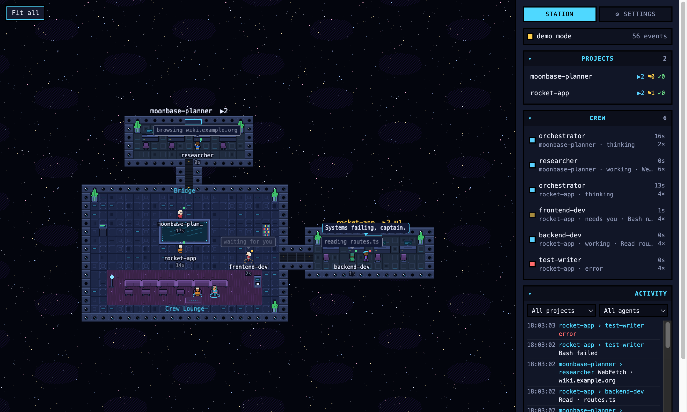
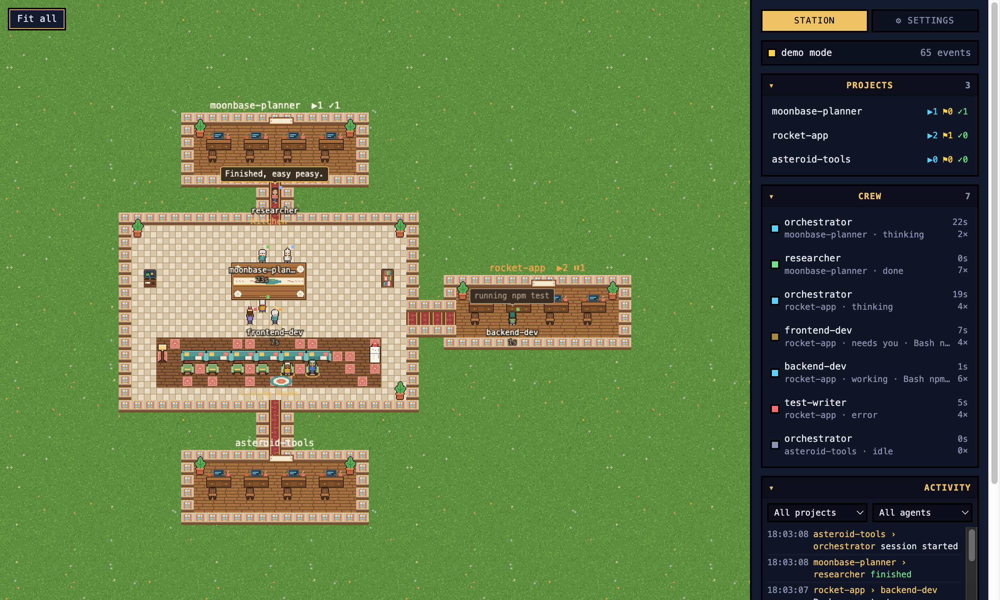

# WSC — Work Space Claude

**Watch your Claude Code agents work, live, on a 2D pixel-art station.**


When Claude Code delegates to subagents, all you normally see is scrolling text. WSC turns that into a small living crew:

- each session's **orchestrator** sits at the central command table;
- idle crew relax in the **lounge**;
- subagents **walk out to their project's zone** and animate what they're actually doing: reading, editing, running tests, searching the web;
- they **walk back to report** when they finish, fail or need your input.

Two projects at once? Each gets its own zone, and a new one unfolds the moment you start working in another folder.

- **Zero cost.** It never calls a model API. Claude Code keeps running on your normal subscription.
- **Local only.** The app listens on `127.0.0.1` only and makes no internet requests: no telemetry, no analytics, no accounts.
- **Watch-only.** No chat box, no prompts, no file edits. You keep typing to Claude Code in your terminal exactly as before.
- **Never slows Claude Code down.** If the app is closed, the hooks exit silently in milliseconds.

## Quick install

```
/plugin marketplace add OWNER/wsc
/plugin install wsc@wsc
```

Then download the app for macOS, Windows or Linux from [Releases](https://github.com/OWNER/wsc/releases) and type `/station` in Claude Code.

**→ Full step-by-step guide: [SETUP.md](SETUP.md)** It covers unsigned-app warnings, manual hook install without the plugin, and uninstalling.

## Usage

| In Claude Code          | Does                                                                              |
| ----------------------- | --------------------------------------------------------------------------------- |
| `/station`              | Open the station, or bring it to the front. You can also say "open the station".  |
| `/station compact`      | Small always-on-top floating view for a screen corner                             |
| `/station theme <name>` | Switch theme live: `spaceship`, `office`, `home`, `terminal` or a community theme |
| `/station demo`         | Play the scripted demo, which needs no Claude Code activity                       |
| `/station status`       | Is it running, on which port, how many events                                     |

If another plugin also defines `station`, the namespaced `/wsc:station` works too.

In the app:

- Drag to pan, scroll or pinch to zoom, press `0` to fit everything.
- Click a zone to fly to it, or a crew member to inspect it.
- The side panel lists projects, crew (status, current tool, elapsed time, tool calls) and a filterable activity log.
- The tray icon's dot turns to **needs input** whenever an agent is waiting for you.

## Themes

Four built-in themes, all generated in code as crisp, integer-scaled pixel art:

| Spaceship (default)                                | Office                                           |
| -------------------------------------------------- | ------------------------------------------------ |
|  |      |
| **Home**                                           | **Terminal**                                     |
|            |  |

Each theme has its own voice. Spaceship crew answer "Aye, captain!"; the Home crew are more like "Sure thing!"

### Community themes

Themes are a folder holding a `theme.json` file plus optional PNG sprite sheets. Drop one into the app-data `themes/` folder and switch to it with `/station theme <id>`. Writing your own takes one JSON file: start from the [theme guide](docs/themes.md) and its [minimal example](docs/examples/minimal-theme).

_Built a theme? [Submit it](CONTRIBUTING.md#submitting-a-theme) and it'll be listed here._

## How it works

```
Claude Code ──hooks──▶ forward.mjs ──POST 127.0.0.1──▶ WSC app ──▶ pixel-art station
   (any number of          (silent,          (token-checked,   (normalize → state →
    sessions/projects)      always exit 0)    local only)        crew choreography)
            └── ~/.claude/projects/*.jsonl ── read on launch to restore running agents
```

The station layout is the same in every theme:

```
        ┌──────────── Project zone: "project-a" ─────────┐
        │  desk  desk  desk  desk                        │
        └────────────────────────────────────────────────┘
┌───── zone ─────┐   ┌──────── CENTER ────────┐   ┌───── zone ─────┐
│ "project-b"    │   │   command table:       │   │ "project-c"    │
│ desk desk      │◀─▶│   orchestrator seats   │◀─▶│ desk desk      │
│ desk desk      │   │   lounge: idle crew    │   │ desk desk      │
└────────────────┘   └────────────────────────┘   └────────────────┘
```

- **Projects** are grouped by working folder.
- **Agents** are matched to their own sessions and subagents using the ids Claude Code puts in every hook event, so nothing is guessed.

Details: [docs/architecture.md](docs/architecture.md) and [docs/claude-code-integration.md](docs/claude-code-integration.md).

## Privacy

Tool inputs can contain secrets and private code, so WSC keeps only what the picture needs:

- the tool name;
- a short sanitized summary: a file basename, a website hostname, or the first ~60 characters of a command with tokens, keys, passwords and `Authorization` headers redacted.

This applies to the side panel **and** to speech bubbles. Your prompts and tool output are never stored, and nothing is written to disk except settings. Tests feed realistic secrets through the whole pipeline and assert none of them reach the screen. See [SECURITY.md](SECURITY.md).

## Roadmap

Not in v1, but planned:

- **Light controls** (still no prompting): open a terminal for a project, jump to a project folder, focus/zoom from the tray.
- **Hand-made pixel art** per theme. Community artists are welcome; the sprite-sheet pipeline is ready.
- **Codex CLI adapter:** show Codex sessions from `~/.codex/sessions/` in their own zones.
- Session replay and a timeline scrubber from transcripts.
- Sound packs per theme.
- Shareable short GIF export of a run, with redaction on.
- More built-in and community themes.

## Contributing

Bug reports, features and especially **themes** are welcome. Start with [CONTRIBUTING.md](CONTRIBUTING.md). If you use Claude Code to contribute, it will pick up [CLAUDE.md](CLAUDE.md) automatically.

## License

[MIT](LICENSE). All art is generated in code; see [ASSETS_LICENSES.md](ASSETS_LICENSES.md).

_Not affiliated with or endorsed by Anthropic. Claude and Claude Code are trademarks of Anthropic._
