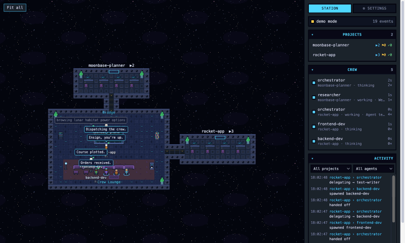
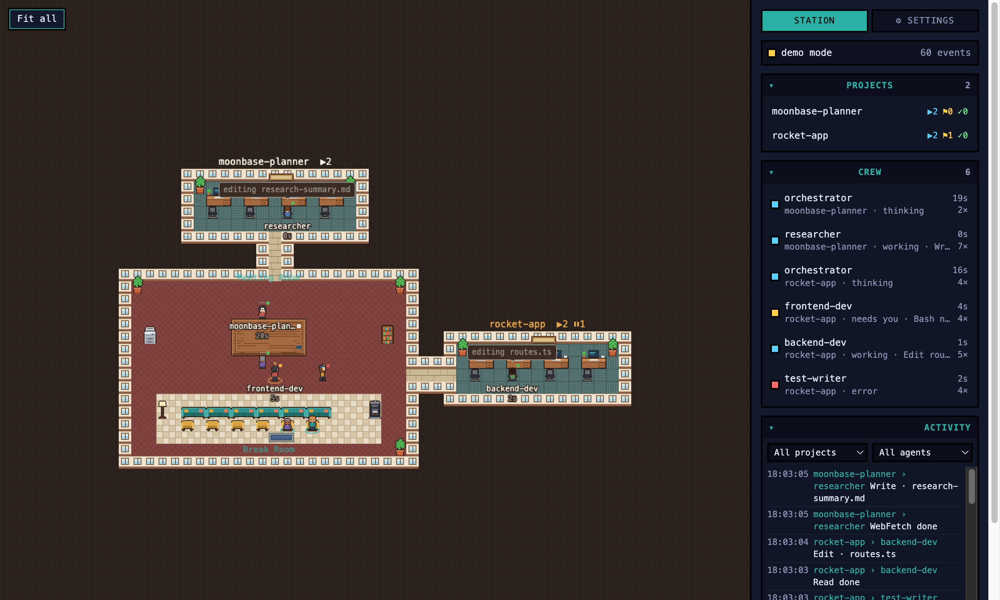
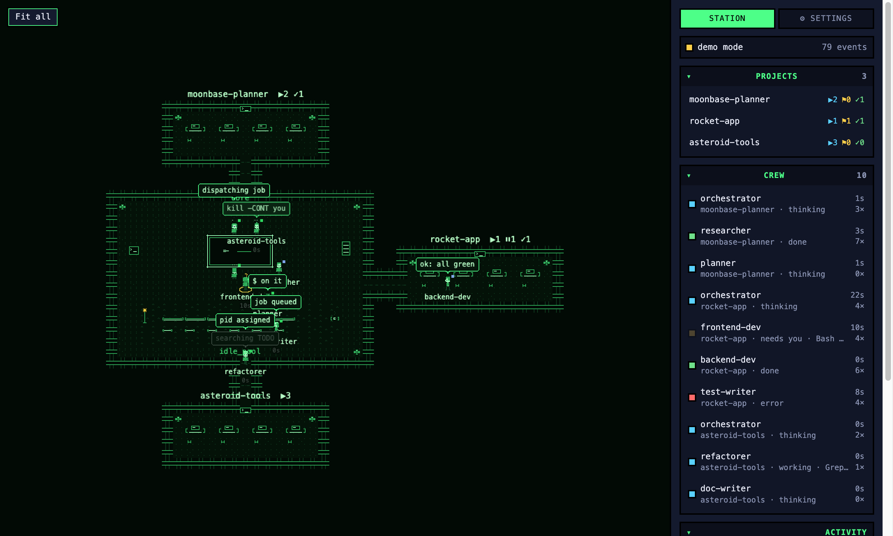

# WSC — Work Space Claude

**Watch your Claude Code agents work, live, on a 2D pixel-art station.**



When Claude Code delegates to subagents, all you normally see is scrolling text. WSC turns that into a small living crew:

- each session's **orchestrator** sits at the central command table;
- idle crew relax in the **lounge**;
- subagents **walk out to their project's zone** and animate what they're actually doing: reading, editing, running tests, searching the web;
- they **walk back to report** when they finish, fail or need your input.

Two projects at once? Each gets its own zone, and a new one unfolds the moment you start working in another folder.

- **Zero cost.** It never calls a model API. Claude Code keeps running on your normal subscription.
- **Local only.** The app listens on `127.0.0.1` only and makes no internet requests: no telemetry, no analytics, no accounts.
- **Watch-only.** No chat box, no prompts, no file edits. You keep typing to Claude Code in your terminal exactly as before.
- **Never slows Claude Code down.** If the app is closed, the hooks exit silently in milliseconds.

## Quick install

```
/plugin marketplace add OWNER/wsc
/plugin install wsc@wsc
```

Then download the app for macOS, Windows or Linux from [Releases](https://github.com/OWNER/wsc/releases) and type `/station` in Claude Code.

**→ Full step-by-step guide: [SETUP.md](SETUP.md)** It covers unsigned-app warnings, manual hook install without the plugin, and uninstalling.

## Usage

| In Claude Code          | Does                                                                              |
| ----------------------- | --------------------------------------------------------------------------------- |
| `/station`              | Open the station, or bring it to the front. You can also say "open the station".  |
| `/station compact`      | Small always-on-top floating view for a screen corner                             |
| `/station theme <name>` | Switch theme live: `spaceship`, `office`, `home`, `terminal` or a community theme |
| `/station demo`         | Play the scripted demo, which needs no Claude Code activity                       |
| `/station status`       | Is it running, on which port, how many events                                     |

If another plugin also defines `station`, the namespaced `/wsc:station` works too.

In the app:

- Drag to pan, scroll or pinch to zoom, press `0` to fit everything.
- Click a zone to fly to it, or a crew member to inspect it.
- Right-click a zone and choose **Remove from station** to hide it. It comes back as soon as
  Claude Code does something new in that folder.
- The side panel lists projects, crew (status, current tool, elapsed time, tool calls) and a filterable activity log.
- The tray icon's dot turns to **needs input** whenever an agent is waiting for you.

### Auto-launch

When a Claude Code session starts and WSC isn't running, the plugin's `SessionStart` hook starts
it in the background (your terminal keeps focus) and hands it the new session. If WSC is already
running, the session simply appears in the same window — there is only ever one instance. Turn
this off with **Settings → Launch on session start**, or `WSC_AUTOLAUNCH=0`; **Focus on session
start** brings the window to the front instead. Start WSC once by hand after installing so the
hook knows where the app is.

## Dashboard

The left column of the window is a live dashboard that shares its data with the station, so the
two never disagree. Collapse it to a slim rail with `«`; clicking a session card selects that
session's orchestrator on the station, and clicking a crew member selects its session here. Two
tabs sit in its header: **Live** (below) and [**Stats**](#stats).

- **Usage window:** tokens used in the current window across **all** sessions, time until it
  resets, burn rate (tokens/min over the last 10 min), the projected total at reset, and the
  weekly total (last 7 days).
- **Session cards:** active sessions first. Status (**working**, **waiting for you**, **idle**,
  **ended**), project, git branch, short session id, models, what it is doing right now
  ("Editing app.ts", "Running npm test", "Reading 3 files"), start time, last activity,
  duration, tokens and subagents.
- **Session detail:** a timeline of prompts, tool calls, subagents and errors (newest first), and
  input / output / cache-write / cache-read tokens, per model when more than one was used.
- **Tokens per hour:** the last 24 hours, stacked by project.

**How the usage estimate works.** Claude Code records each API response's token usage in its
local transcripts (`~/.claude/projects/**/*.jsonl`). WSC reads them incrementally — only new
bytes — and counts each response once. "Tokens" means input + output + cache write. Cache reads
are shown separately but not counted: every API call re-reads the whole cached conversation, so
they repeat tokens already counted and would make up ~98% of the total.
A window starts at the first activity after the previous window ended, rounded down to the hour,
and lasts `usageWindowHours` (5 by default) — a common community convention, so treat it as an
estimate. The transcripts don't contain your plan's real allowance, so there is no percentage
until you set your own limits (`windowTokenLimit`, `weeklyTokenLimit`); then the bars turn
amber at 75 % and red at 90 %. The exact remaining quota is only shown by Claude Code's own
`/usage` command.

### Stats

The **Stats** tab is a look back over your history, in the spirit of Claude Code's `/stats`. Pick
**7d** (today and the 6 days before), **30d** (the default) or **All**:

- **Tiles:** total tokens and responses, sessions, active days, current and longest streak,
  longest session (active time; pauses over 30 minutes don't count), busiest day, peak hour,
  favourite model, and an estimated cost when `prices` covers every model in the range.
- **Activity:** tokens per day, as bars for 7d and as a calendar heatmap for 30d and All (the
  most recent 53 weeks).
- **Models** by share of tokens, **tokens per hour of day**, and the **top 5 projects**.

Days and hours are your local time. Streaks count your whole history, whatever the range; under
7d and 30d their tiles say _all history_.

**Where the numbers come from.** The same usage lines as the live dashboard, but from every
transcript still under `~/.claude/projects` (or `$CLAUDE_CONFIG_DIR/projects`), not just the last
`lookbackDays`. Each response is counted once. Totals here include cache reads, the way Claude Code's `/stats`
counts them, so they are far larger than the Live tab's numbers, which leave cache reads out; the
total tile shows both. Its limits:

- **Only what is still on this machine.** Claude Code deletes old transcripts, so **All** reaches
  back only as far as they do. The note at the bottom of the tab shows the oldest day found.
- **Nothing is read until you open the tab.** The first open reads the whole history, and the
  numbers grow while _still reading history_ shows. After that only changed files are read again,
  quietly, at most once a minute and only while the tab is open.
- **Nothing is stored.** WSC keeps the numbers in memory and writes none of them to disk. Five
  minutes after you close the tab (or hide the window) it lets go of them, and the next open, or
  a restart, reads the history again.
- Demo mode shows made-up history and reads no transcripts. The tab switches to it, or back to
  your own history, as soon as the demo starts or ends.

### Settings

Everything is in **Settings** (right panel) and saved to `settings.json` in the app-data folder
(`~/Library/Application Support/WSC` on macOS, `%APPDATA%\WSC` on Windows, `~/.config/WSC` on
Linux).

| Setting                | Default | Meaning                                                                                       |
| ---------------------- | ------- | --------------------------------------------------------------------------------------------- |
| `launchOnSessionStart` | `true`  | The `SessionStart` hook starts WSC when it isn't running                                      |
| `focusOnSessionStart`  | `false` | Bring the window to the front when a session starts (off: never steal focus)                  |
| `dashboardOpen`        | `true`  | Dashboard column expanded (it auto-collapses in narrow windows)                               |
| `lookbackDays`         | `7`     | Transcripts changed within this many days are read at startup                                 |
| `idleMinutes`          | `10`    | A session with no activity for this long shows as idle                                        |
| `usageWindowHours`     | `5`     | Length of the usage window                                                                    |
| `windowTokenLimit`     | `null`  | Your calibrated token limit per window; enables the % bar                                     |
| `weeklyTokenLimit`     | `null`  | Same, per 7 days                                                                              |
| `showPromptPreview`    | `false` | Show the start of your latest prompt on its card (redacted, 120 chars, memory only)           |
| `prices`               | `{}`    | Optional cost estimate, USD per million tokens by model-id substring (no prices are built in) |
| `port`                 | `47821` | Preferred local port (falls back to a free one)                                               |

You can also edit `settings.json` by hand, even while WSC runs: saves re-read the file first, so
your edits are kept. If the file can't be parsed, WSC runs on defaults, shows a banner, and keeps
your file as `settings.json.corrupt-<timestamp>` before it next saves.

`prices` example (fill in the numbers from your own price list) — a model is priced by the longest
key its id contains, and costs are shown only when every model in the range has a price. An invalid
entry is ignored with a banner, and stays in the file for you to fix:

```json
"prices": {
  "opus": { "input": 0, "output": 0, "cacheWrite": 0, "cacheRead": 0 }
}
```

## Hooks without the plugin

The plugin is the recommended install. If you don't use it, merge the same hooks into
`~/.claude/settings.json` from a WSC checkout:

```sh
npm run hooks:install     # backs up settings.json, merges WSC's hooks, keeps everything else
npm run hooks:uninstall   # removes only WSC's hook entries; the app stays installed
```

Both are idempotent and accept `-- --settings <path>`. Install refuses while the `wsc@wsc` plugin
is enabled, because both copies of each hook would fire (`--force` overrides).

### Plan usage bars (status line bridge)

Claude Code gives your real plan usage (the 5-hour and weekly limits the Claude app shows) only
to the status line command, and plugins can't add one, so install the bridge into your settings
to see those bars in WSC (plugin users too):

```sh
npm run statusline:install     # backs up settings.json; an existing status line keeps working
npm run statusline:uninstall   # restores your previous status line exactly
```

It sends only the session id and the `rate_limits` numbers to the local app, prints nothing of its
own and accepts `-- --settings <path>` too.

Having trouble (port in use, hooks not firing, stale lock file, app not launching)? See
[docs/troubleshooting.md](docs/troubleshooting.md).

## Themes

Four built-in themes, all generated in code as crisp, integer-scaled pixel art:

| Spaceship (default)                                | Office                                           |
| -------------------------------------------------- | ------------------------------------------------ |
|  |      |
| **Home**                                           | **Terminal**                                     |
|            |  |

Each theme has its own voice. Spaceship crew answer "Aye, captain!"; the Home crew are more like "Sure thing!"

### Community themes

Themes are a folder holding a `theme.json` file plus optional PNG sprite sheets. Drop one into the app-data `themes/` folder and switch to it with `/station theme <id>`. Writing your own takes one JSON file: start from the [theme guide](docs/themes.md) and its [minimal example](docs/examples/minimal-theme).

_Built a theme? [Submit it](CONTRIBUTING.md#submitting-a-theme) and it'll be listed here._

## How it works

```
Claude Code ──hooks──▶ forward.mjs ──POST 127.0.0.1──▶ WSC app ──▶ pixel-art station
   (any number of          (silent,          (token-checked,   (normalize → state →
    sessions/projects)      always exit 0)    local only)        crew choreography)
            └── ~/.claude/projects/**/*.jsonl ── watched live: usage, timelines, sessions without hooks
```

The station layout is the same in every theme:

```
        ┌──────────── Project zone: "project-a" ─────────┐
        │  desk  desk  desk  desk                        │
        └────────────────────────────────────────────────┘
┌───── zone ─────┐   ┌──────── CENTER ────────┐   ┌───── zone ─────┐
│ "project-b"    │   │   command table:       │   │ "project-c"    │
│ desk desk      │◀─▶│   orchestrator seats   │◀─▶│ desk desk      │
│ desk desk      │   │   lounge: idle crew    │   │ desk desk      │
└────────────────┘   └────────────────────────┘   └────────────────┘
```

- **Projects** are grouped by working folder.
- **Agents** are matched to their own sessions and subagents using the ids Claude Code puts in every hook event, so nothing is guessed.

Details: [docs/architecture.md](docs/architecture.md) and [docs/claude-code-integration.md](docs/claude-code-integration.md).

## Privacy

Tool inputs can contain secrets and private code, so WSC keeps only what the picture needs:

- the tool name;
- a short sanitized summary: a file basename, a website hostname, or the first ~60 characters of a command with tokens, keys, passwords and `Authorization` headers redacted.

This applies to the side panel, the dashboard **and** speech bubbles. Your prompts and tool output are never stored — unless you turn on `showPromptPreview`, which keeps a redacted 120-character preview of the latest prompt in memory only. From transcripts WSC reads token counts, model ids and git branch names. Nothing is written to disk except settings and a few small runtime files. Tests feed realistic secrets through the whole pipeline and assert none of them reach the screen. See [SECURITY.md](SECURITY.md).

## Roadmap

Not in v1, but planned:

- **Light controls** (still no prompting): open a terminal for a project, jump to a project folder, focus/zoom from the tray.
- **Hand-made pixel art** per theme. Community artists are welcome; the sprite-sheet pipeline is ready.
- **Codex CLI adapter:** show Codex sessions from `~/.codex/sessions/` in their own zones.
- Session replay and a scrubber over the dashboard timeline.
- Sound packs per theme.
- Shareable short GIF export of a run, with redaction on.
- More built-in and community themes.

## Contributing

Bug reports, features and especially **themes** are welcome. Start with [CONTRIBUTING.md](CONTRIBUTING.md). If you use Claude Code to contribute, it will pick up [CLAUDE.md](CLAUDE.md) automatically.

## License

[MIT](LICENSE). All art is generated in code; see [ASSETS_LICENSES.md](ASSETS_LICENSES.md).

_Not affiliated with or endorsed by Anthropic. Claude and Claude Code are trademarks of Anthropic._
