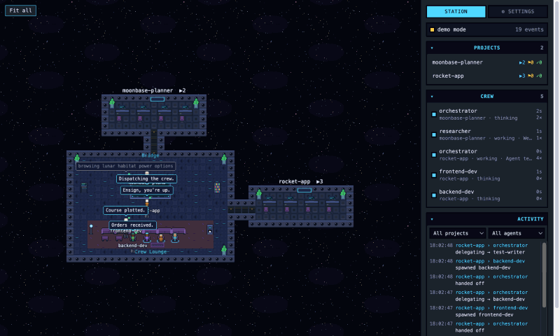

# Setting up WSC

This guide takes you from nothing to watching your Claude Code agents on the station. It takes about five minutes.



## 1. Requirements

- **Claude Code** 2.1.294 or newer. WSC is verified against 2.1.294; check yours with `claude --version`.
- **Node.js** 20 or newer on your `PATH`. The hook forwarder is a tiny Node script; Claude Code already needs Node, so you almost certainly have it.
- **macOS** 13+ (Apple silicon or Intel), **Windows** 10/11 (x64) or **Linux** (x64, AppImage).

WSC costs nothing to run. It never calls a model API, never sends prompts, and never talks to the internet.

## 2. Install the Claude Code plugin

In any Claude Code session, run:

```
/plugin marketplace add Jaber-ja2314817/WSC
/plugin install wsc@wsc
```

`/plugin install` opens a details panel. Pick the **user** scope so the station sees every project. Then run `/reload-plugins`, or restart Claude Code.

The plugin adds two things:

- **Hooks** that forward agent activity to the app on `127.0.0.1`. When the app isn't running, they exit silently in milliseconds.
- **The `/station` command.** If another plugin also defines `station`, use `/wsc:station`.

## 3. Download and install the app

Download the latest release from **https://github.com/Jaber-ja2314817/WSC/releases**.

| OS      | File                                                                                 |
| ------- | ------------------------------------------------------------------------------------ |
| macOS   | `WSC-<version>-mac-arm64.dmg` (Apple silicon) or `WSC-<version>-mac-x64.dmg` (Intel) |
| Windows | `WSC-<version>-win-x64.exe`                                                          |
| Linux   | `WSC-<version>-linux-x86_64.AppImage`                                                |

The builds are **not code-signed yet**, so your OS will warn you the first time.

- **macOS:**
  1. Open the DMG and drag **WSC** to **Applications**.
  2. The first time, **right-click WSC → Open → Open**.
  3. If macOS says the app "is damaged", that is Gatekeeper's quarantine flag on unsigned downloads. Clear it with:
     ```sh
     xattr -dr com.apple.quarantine /Applications/WSC.app
     ```
- **Windows:** run the installer. If SmartScreen shows "Windows protected your PC", click **More info → Run anyway**.
- **Linux:**
  ```sh
  chmod +x WSC-*.AppImage
  mkdir -p ~/Applications && mv WSC-*.AppImage ~/Applications/
  ```
  The `/station` launcher looks in `~/Applications`. You can also put it anywhere and set `WSC_APP_PATH`.

Only bypass these warnings for files you downloaded from the official releases page. If you'd rather not, see [Run from source](#run-from-source).

## 4. Open the station

In Claude Code, type:

```
/station
```

The app starts in the background, or comes to the front if it's already open, and Claude replies with one line such as `WSC: starting…`. You can also just say "open the station".

| Command                 | What it does                                                    |
| ----------------------- | --------------------------------------------------------------- |
| `/station`              | open or focus the station                                       |
| `/station compact`      | small always-on-top floating view                               |
| `/station theme <name>` | `spaceship`, `office`, `home`, `terminal`, or a community theme |
| `/station demo`         | play the scripted demo                                          |
| `/station status`       | is it running, on which port, how many events                   |

## 5. Watch your agents work

Run something multi-agent in Claude Code. For example: _"Use two subagents in parallel: one reviews the tests, one updates the docs."_

- **The center** is the command table. Each Claude Code session's lead agent, the **orchestrator**, sits there, labeled with its project.
- **The lounge** below the table holds idle crew. When a subagent starts, a crew member takes its name, says something like "On it!", and walks to its project's zone.
- **Project zones** surround the center, one per working folder. The nameplate shows how many agents are working, waiting and done. A new zone unfolds as soon as you start Claude Code in another folder.
- **At a desk**, each agent animates what it's doing: reading, editing, running commands, searching the web, and so on. A bubble shows short, sanitized status text such as "reading auth.ts".
- **Reporting:** when an agent finishes, fails or needs you, it walks to the center to report. An agent waiting for your permission stays highlighted, and its zone's nameplate flashes, until you answer in the terminal.

**Navigation:**

- Drag to pan; scroll or pinch to zoom.
- Keyboard: `+`, `-`, arrow keys or WASD.
- `0` or the **Fit all** button shows the whole station.
- Click a zone or a project in the side panel to fly to it.
- Click a crew member to select it in the side panel.

**Already-running sessions are restored.** If you open WSC while agents are already working, it rebuilds the last 30 minutes from Claude Code's local transcripts.

## 6. Themes, compact mode and settings

- **Themes:** Spaceship (default), Office, Home and Terminal. Switch with `/station theme office`, the tray menu, or Settings. Switching is live and keeps everything on screen.
- **Compact mode:** `/station compact` or the tray menu opens a small frameless window that floats above other windows. It suits a screen corner.
- **Tray / menu-bar icon:**
  - The dot shows idle, working or **needs input**.
  - The menu has Show, Compact mode, Theme, Pause updates and Quit.
- **Settings:** open from the side panel. Saved to `settings.json` in the app-data folder ([see below](#10-uninstall)). They cover:
  - theme, port and lounge size;
  - report frequency (minimal, normal, chatty);
  - stale, linger and idle-project timeouts;
  - status and catchphrase bubbles, and full tool details (off by default);
  - notifications (off), reduce motion (follows the OS) and launch at login (macOS and Windows; the toggle is hidden on Linux);
  - custom tool → category mappings.

  You can also edit `settings.json` by hand, even while WSC runs: saves re-read the file first, so your edits are kept. If the file can't be parsed, WSC runs on defaults, shows a banner, and keeps your file as `settings.json.corrupt-<timestamp>` before it next saves.

## 7. Manual hook install (without the plugin)

If you don't use plugins, add the hooks yourself.

**From a checkout, the quick way:** `npm run hooks:install` merges them into `~/.claude/settings.json` for you (backup first, idempotent, existing hooks kept); `npm run hooks:uninstall` removes only WSC's entries. It refuses while the `wsc@wsc` plugin is enabled, since both copies of each hook would fire. By hand:

1. Get the files.
   - Clone the repo: `git clone https://github.com/Jaber-ja2314817/WSC`
   - Or use the copy inside the app:
     - macOS: `/Applications/WSC.app/Contents/Resources/plugin`
     - Windows: `%LOCALAPPDATA%\Programs\WSC\resources\plugin`
     - Linux: `resources/plugin` inside the extracted AppImage
2. **Merge** the snippet below into `~/.claude/settings.json`.
   - **Do not overwrite the file.** If you already have a `"hooks"` key, add these events to it.
   - If an event already has entries, append this matcher group to its array.
   - Replace `/ABSOLUTE/PATH/TO/wsc/plugin` with the real path. On Windows, use forward slashes or escaped backslashes.
3. Restart Claude Code.

The first-run screen in the app shows the same snippet, with a **Copy** button.

```json
{
  "hooks": {
    "SessionStart": [
      {
        "hooks": [
          {
            "type": "command",
            "command": "node",
            "args": ["/ABSOLUTE/PATH/TO/wsc/plugin/hooks/forward.mjs"],
            "async": true,
            "timeout": 5
          }
        ]
      }
    ],
    "SessionEnd": [
      {
        "hooks": [
          {
            "type": "command",
            "command": "node",
            "args": ["/ABSOLUTE/PATH/TO/wsc/plugin/hooks/forward.mjs"],
            "timeout": 2
          }
        ]
      }
    ],
    "UserPromptSubmit": [
      {
        "hooks": [
          {
            "type": "command",
            "command": "node",
            "args": ["/ABSOLUTE/PATH/TO/wsc/plugin/hooks/forward.mjs"],
            "async": true,
            "timeout": 5
          }
        ]
      }
    ],
    "PreToolUse": [
      {
        "hooks": [
          {
            "type": "command",
            "command": "node",
            "args": ["/ABSOLUTE/PATH/TO/wsc/plugin/hooks/forward.mjs"],
            "async": true,
            "timeout": 5
          }
        ]
      }
    ],
    "PostToolUse": [
      {
        "hooks": [
          {
            "type": "command",
            "command": "node",
            "args": ["/ABSOLUTE/PATH/TO/wsc/plugin/hooks/forward.mjs"],
            "async": true,
            "timeout": 5
          }
        ]
      }
    ],
    "PostToolUseFailure": [
      {
        "hooks": [
          {
            "type": "command",
            "command": "node",
            "args": ["/ABSOLUTE/PATH/TO/wsc/plugin/hooks/forward.mjs"],
            "async": true,
            "timeout": 5
          }
        ]
      }
    ],
    "PostToolBatch": [
      {
        "hooks": [
          {
            "type": "command",
            "command": "node",
            "args": ["/ABSOLUTE/PATH/TO/wsc/plugin/hooks/forward.mjs"],
            "async": true,
            "timeout": 5
          }
        ]
      }
    ],
    "PermissionRequest": [
      {
        "hooks": [
          {
            "type": "command",
            "command": "node",
            "args": ["/ABSOLUTE/PATH/TO/wsc/plugin/hooks/forward.mjs"],
            "async": true,
            "timeout": 5
          }
        ]
      }
    ],
    "PermissionDenied": [
      {
        "hooks": [
          {
            "type": "command",
            "command": "node",
            "args": ["/ABSOLUTE/PATH/TO/wsc/plugin/hooks/forward.mjs"],
            "async": true,
            "timeout": 5
          }
        ]
      }
    ],
    "Notification": [
      {
        "hooks": [
          {
            "type": "command",
            "command": "node",
            "args": ["/ABSOLUTE/PATH/TO/wsc/plugin/hooks/forward.mjs"],
            "async": true,
            "timeout": 5
          }
        ]
      }
    ],
    "SubagentStart": [
      {
        "hooks": [
          {
            "type": "command",
            "command": "node",
            "args": ["/ABSOLUTE/PATH/TO/wsc/plugin/hooks/forward.mjs"],
            "async": true,
            "timeout": 5
          }
        ]
      }
    ],
    "SubagentStop": [
      {
        "hooks": [
          {
            "type": "command",
            "command": "node",
            "args": ["/ABSOLUTE/PATH/TO/wsc/plugin/hooks/forward.mjs"],
            "async": true,
            "timeout": 5
          }
        ]
      }
    ],
    "Stop": [
      {
        "hooks": [
          {
            "type": "command",
            "command": "node",
            "args": ["/ABSOLUTE/PATH/TO/wsc/plugin/hooks/forward.mjs"],
            "timeout": 2
          }
        ]
      }
    ],
    "StopFailure": [
      {
        "hooks": [
          {
            "type": "command",
            "command": "node",
            "args": ["/ABSOLUTE/PATH/TO/wsc/plugin/hooks/forward.mjs"],
            "async": true,
            "timeout": 5
          }
        ]
      }
    ],
    "PreCompact": [
      {
        "hooks": [
          {
            "type": "command",
            "command": "node",
            "args": ["/ABSOLUTE/PATH/TO/wsc/plugin/hooks/forward.mjs"],
            "async": true,
            "timeout": 5
          }
        ]
      }
    ],
    "PostCompact": [
      {
        "hooks": [
          {
            "type": "command",
            "command": "node",
            "args": ["/ABSOLUTE/PATH/TO/wsc/plugin/hooks/forward.mjs"],
            "async": true,
            "timeout": 5
          }
        ]
      }
    ],
    "CwdChanged": [
      {
        "hooks": [
          {
            "type": "command",
            "command": "node",
            "args": ["/ABSOLUTE/PATH/TO/wsc/plugin/hooks/forward.mjs"],
            "async": true,
            "timeout": 5
          }
        ]
      }
    ]
  }
}
```

`Stop` and `SessionEnd` are deliberately **synchronous**, unlike the other events, which are `"async": true`. In `claude -p` runs the process exits before async hooks for the last turn can fire. These two cost about 20 ms when the app is closed.

**Without the plugin there is no `/station` command.** Open the app directly instead, or run `node /ABSOLUTE/PATH/TO/wsc/plugin/scripts/launch.mjs` with the same arguments.

## 8. Install a community theme

1. Download or clone the theme folder. It contains `theme.json` and any PNG files.
2. Copy the folder into the app-data `themes/` directory:
   - macOS: `~/Library/Application Support/WSC/themes/<theme-id>/`
   - Windows: `%APPDATA%\WSC\themes\<theme-id>\`
   - Linux: `~/.config/WSC/themes/<theme-id>/`
3. Run `/station theme <theme-id>`, or pick it from the tray menu. A theme copied in while WSC runs appears without a restart.

Invalid themes fall back to Spaceship and show a warning banner. The station is never blank. To make your own theme, see [docs/themes.md](docs/themes.md).

## 9. Troubleshooting

| Problem                                  | Quick fix                                                                                                                                                                                                       |
| ---------------------------------------- | --------------------------------------------------------------------------------------------------------------------------------------------------------------------------------------------------------------- |
| **Nothing shows up**                     | Run `/station status`. If it says "not running", run `/station`. Check `/plugin` lists **wsc** as enabled, then run `/reload-plugins`. Hooks only fire for sessions started **after** the plugin was installed. |
| **"Test connection" fails**              | Something else may be using port 47821. WSC falls back to a free port automatically; restart the app and Claude Code. Check that `node --version` works in the same shell Claude Code runs in.                  |
| **Agents on the wrong project**          | Projects come from the folder Claude Code was **started** in. A session that later `cd`s keeps its first zone. Start Claude Code from the project root.                                                         |
| **App blocked on macOS**                 | See step 3: `xattr -dr com.apple.quarantine /Applications/WSC.app`.                                                                                                                                             |
| **`/station` says the app wasn't found** | Install the app (step 3), or set `WSC_APP_PATH` to the app's location.                                                                                                                                          |

More in [docs/troubleshooting.md](docs/troubleshooting.md).

## 10. Uninstall

1. **Plugin:** run `/plugin uninstall wsc@wsc`, then `/plugin marketplace remove wsc`.
2. **Manual hooks:** if you added them, run `npm run hooks:uninstall` in the checkout, or remove the forwarder entries from the `"hooks"` key in `~/.claude/settings.json`.
3. **App:**
   - macOS: delete `/Applications/WSC.app`.
   - Windows: **Settings → Apps → WSC → Uninstall**.
   - Linux: delete the AppImage.
4. **App data:** this folder holds `settings.json`, `window-state.json`, `state.json`, `runtime.json`, `launch.json`, `launching.json`, `hook-errors.log` (if an auto-launch failed) and `themes/`.
   - macOS: `rm -rf ~/Library/Application\ Support/WSC`
   - Windows: delete `%APPDATA%\WSC`
   - Linux: `rm -rf ~/.config/WSC`

WSC writes nothing else to your machine. It never modifies Claude Code's transcripts or settings.

## Run from source

```sh
git clone https://github.com/Jaber-ja2314817/WSC && cd WSC
npm install
npm run build
claude --plugin-dir ./plugin   # or install the plugin from the local marketplace: /plugin marketplace add ./
```

With the plugin loaded from a checkout, `/station` launches the app from source with the repo's Electron. For development, `npm run dev` and `npm run demo` are covered in [CONTRIBUTING.md](CONTRIBUTING.md).
